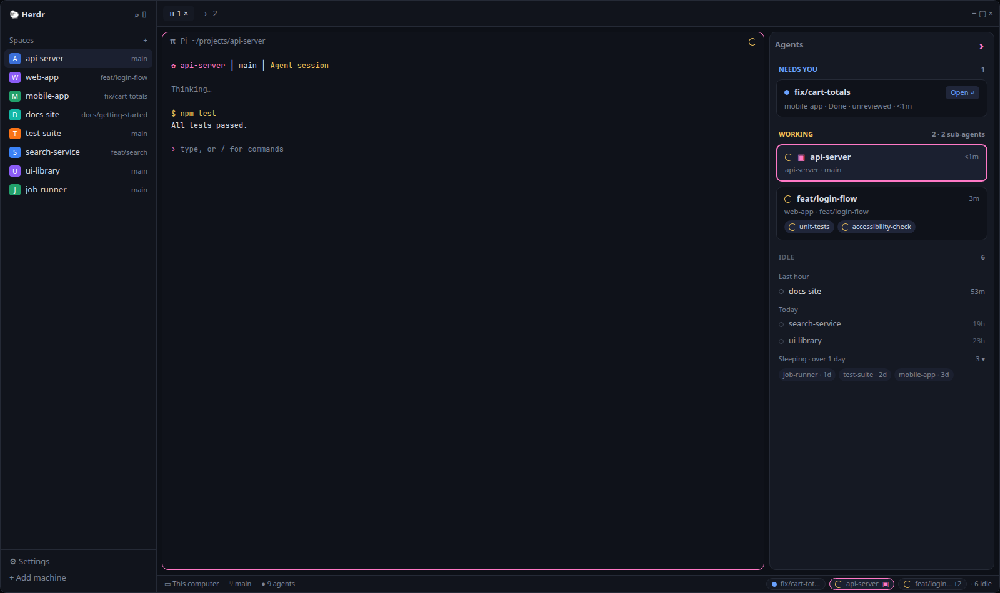

# herdr-agent-board

An activity-first layout for the [Herdr desktop app](https://herdr.dev).
Keep Spaces on the left, terminals in the center, and an **Agent Board** on the
right: **Needs you**, **Working**, then **Idle**, grouped by how long agents have
been inactive. A compact status-bar strip keeps active agents visible even when
the board is collapsed.



The public layout has **no Dictar button or personal-mod dependency**. An optional
local dictate variant can reuse a dictation mod you already have installed.
The two bundled mods run **no programs** and use **no network**. They read Herdr's
live agent model, keep local age/state data, and invoke Herdr UI commands.

## Included files

| Path | Purpose |
|---|---|
| `layouts/agent-board.json` | 250px Spaces sidebar, terminals, 360px board, 28px status row with a 440px active-agent strip. |
| `mods/agent-board/` | Activity board, docked 52px rail, and hover overlay. |
| `mods/agent-strip/` | Active-agent pills and idle count. |
| `install.sh` | Copies only this layout and these two mods, then checks both mods. |
| `RECIPE.md` | Gallery build brief based on the actual implementation. |
| `docs/prototype.html` | Static English visual reference; view D is the default. Add `?preview` for a window-only view. |
| `docs/SPEC*.md` | Layout and behavior specifications. |
| `odd/tasks/agent-board.md` | Requirements, decisions, and historical verification notes. |

## Requirements

- Herdr installed, running, and `herdr-app` available on `PATH`.
- Herdr's shipped `workspace-chrome`, `workspace-status`, `spaces`, `tabs`,
  `pane`, `files`, and `changes` mods, including the `workspace-chrome` SVG assets.
- A POSIX shell. Only the optional dictate variant also needs Python 3.

No personal mods are needed for the public layout. Before installation, check
that you do not already have unrelated files named `agent-board` or `agent-strip`:
the installer overwrites its own destination files to support updates. For a
name clash, rename the incoming layout/mods and their references first.

## Install

After the repository is published under its English name:

```sh
git clone https://github.com/luisdamora/herdr-agent-board.git
cd herdr-agent-board
sh install.sh
herdr-app do layout.switch '{"name":"agent-board"}'
```

The installer copies `layouts/agent-board.json` and each bundled mod's `main.js`
and `mod.json` into `${HERDR_APP_HOME:-$HOME/.config/herdr-app}`. It runs
`herdr-app check` on both mods and stops on a failed check. It never deletes
anything, switches layouts, restarts Herdr, or edits keys/settings/other mods.
Herdr hot-reloads the copied files. Existing legacy installations are left alone.

To use another Herdr home:

```sh
HERDR_APP_HOME=/path/to/herdr-app sh install.sh
```

## Update

```sh
cd herdr-agent-board
git pull
sh install.sh
```

Edit source in this repository, not the installed copies, then rerun the
installer. If you use the local dictate variant, include `HERDR_DICTATE_MOD`
again on updates to regenerate it.

## Optional local dictate variant

Keep dictation private: install your own dictate-button mod separately, then:

```sh
HERDR_DICTATE_MOD=mi-boton sh install.sh
herdr-app do layout.switch '{"name":"agent-board-dictate"}'
```

The variable is a folder name, not a path (letters, digits, underscores, and
hyphens). The installer first checks for
`$DEST/mods/$HERDR_DICTATE_MOD/main.js`, where `DEST` is the selected Herdr home.
A missing mod fails with its expected path before copying anything. Python 3 is
required only when this option is set.

This also writes `layouts/agent-board-dictate.json` in the Herdr home, appending
a 168px `dictate` block after the active strip in the status row. The public
layout remains unchanged. No personal mod is copied into this repository or
published. Without the variable, only the public layout is installed/updated;
an existing local variant is neither changed nor removed.

## Switch back

- **Ctrl+Shift+L** cycles through installed layouts.
- Or select a known layout explicitly:

```sh
herdr-app do layout.switch '{"name":"main"}'
```

Your previous layouts are not modified.

## Uninstall

Switch to another layout first. Then manually remove only these installed files:

- `~/.config/herdr-app/layouts/agent-board.json`
- `~/.config/herdr-app/mods/agent-board/`
- `~/.config/herdr-app/mods/agent-strip/`
- `~/.config/herdr-app/layouts/agent-board-dictate.json`, if you generated it.

Substitute your custom Herdr home if needed. Keep your personal dictate mod and
any other layouts/mods. The installer does not perform uninstallation.

## Usage

### Activity board

- **Needs you**: blocked agents awaiting approval and done agents whose work is
  unreviewed. Click a card or **Open ↵** to focus its pane.
- **Working**: name, space, branch when available, age, and live sub-agent chips.
  Click a chip to focus its pane, or open a terminal preview when it has no pane.
- **Idle**: **Last hour** uses rows, **Today** uses dimmer rows, and
  **Sleeping · over 1 day** uses chips. Click the sleeping header to fold them.
- The current agent has an accent border, selected background, and a monitor
  icon with the **You are here** tooltip. A current sleeping agent stays visible
  as a row even when the sleeping chips are folded.

Ages refresh every 30 seconds and start when the mod first observes an agent.
Viewing a done agent does not reset its age when it becomes idle. Cards contain
no command output box or progress line; working status icons still spin.

### Collapse and hover

- The header's **Collapse** button reduces the panel to a **52px docked rail**;
  the terminal gets the remaining width. Each 36px cell has a 16px program icon
  and an 8px status badge. The current agent stays highlighted.
- Hover opens a **360px overlay** over the terminal, aligned to the rail's right,
  top, and bottom edges. Leaving closes it after a 180ms grace period.
- After clicking Collapse, leave the rail once to arm hover-open; otherwise the
  pointer left over the button would immediately reopen the board.
- **Pin panel** restores the remembered expanded width. Collapsed state and width
  use namespaced shared state and survive reloads. The sleeping fold is per copy.

### Status strip

Blocked, done, and working agents appear as pills in that order, with names
truncated to 14 characters, `+N` live sub-agents, and a trailing idle count. Click
a pill to focus its pane. The current agent is highlighted. The strip scrolls
horizontally if the pills do not fit.

## CLI commands

```sh
herdr-app do agent-board.collapse
herdr-app do agent-board.expand
herdr-app do agent-board.peek
herdr-app do agent-board.unpeek
```

`peek` requires a collapsed, measured rail and armed hover state. `expand` pins
the board again. `unpeek` dismisses a stuck hover overlay.

## Checks

```sh
sh -n install.sh
python3 -m json.tool layouts/agent-board.json
herdr-app check ~/.config/herdr-app/mods/agent-board
herdr-app check ~/.config/herdr-app/mods/agent-strip
herdr-app status
herdr-app shot /tmp/herdr-shots/agent-board.png
```

Status should report `"layout": "agent-board"` (or `"agent-board-dictate"` for
the local variant) and `"errors": []`. Ensure the screenshot directory exists.
Look at the shot: native checks do not exercise deferred rows, hover, or clicks.
Real-window screenshots may contain terminal content; review before sharing.
The gallery preview is rendered from neutral prototype data instead.

## Known limits

- Hover depends on Herdr pointer events; `agent-board.unpeek` is the escape hatch.
  Real-pointer hover transitions still need manual verification.
- Age tracking is local observation, not historical core activity. The new mod
  namespace does not migrate the legacy board's saved state.
- Spaces does not show working/done tags; that would require a separate clone.
- The board depends on shipped `workspace-chrome` icons and Herdr's native API.
- The prototype is a static visual reference, not an interactive mod emulator.
- The public repository intentionally does not include a dictation mod.

## Gallery publication

Use the repository name **herdr-agent-board**, include `RECIPE.md` and
`preview.png`, and add the GitHub repository topic **`herdr-layout`**. Herdr's
gallery discovers public repositories with that topic, usually within an hour.
Renaming the remote repository and setting its topic are separate publishing
steps; editing these files does not perform them.
