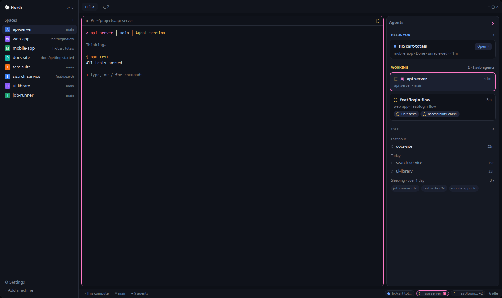

# Agent Board

An activity-first Herdr window: Spaces on the left, framed terminals in the
center, and an agent board on the right that puts work needing attention first.
Collapse the board into a docked icon rail; hover to read it over the terminal,
or pin it open again. A status-bar strip keeps active agents in view. The public
layout includes no personal dictation button.



## What you see

- **Window:** no system titlebar, traffic lights at [12, 16]. Use the person's
  theme/fonts rather than fixing a theme. Root background `canvas`, 1px `border`
  divider; terminal padding [14, 12]px.
- **Left sidebar:** 250px wide (min 44, max 480), `chrome`. A 46px brand bar,
  Spaces filling the remaining height (min 90px), then a 69px settings/machine
  footer. No second agent list here.
- **Top of work area:** 42px tabs bar, including the shipped window controls.
- **Center:** 8px work-body padding/gaps. Active-tab terminals have 30px headers
  always on top, `background`, 1px `border`, 1px `accent` focus border, radius 10,
  gap 8; frame a lone pane too.
- **Right:** a 360px activity board (min 48, max 600), `surface`, 1px `border`,
  radius 10. Header **Agents**, with a right-chevron Collapse button. Body text
  12.5px; uppercase 11px section headings with counts. Needs you uses `blocked`
  if any agent is blocked, otherwise `done`; Working uses `working`; Idle uses
  `idle`. Labels/metadata use `muted` and `dim`; names use `foreground`.
- **Cards:** horizontal margin 10px, bottom margin 8px, padding [10, 12]px,
  radius 9, `background`, 1px `border`. Current agent: `selected`, 2px `accent`
  border and a 13px monitor marker. Age, space, branch and sub-agent chips fit
  below/alongside the name; no command output or progress line.
- **Idle rows:** margin 6px, padding [5, 8]px, gap 8, radius 7. Today rows at
  0.7 opacity unless current. Sleeping chips: padding [3, 7]px, radius 99,
  max width 300, `raised`, 0.55 opacity. Current sleeping agent remains a row.
- **Collapsed rail:** 52px column inside the same card frame. 40px pin header;
  36px cells with 4px gaps, 16px program icons, 8px bottom-right status badges.
  Current cell: radius 8, `selected`, 1px `accent`. Idle opacity 0.55, sleeping
  0.35, current always 1. Group breaks use a 12px gap with a centered 16×1px
  `border` line; Needs you alone gets a nonzero count badge.
- **Bottom:** 28px status row, workspace status weight 1 and a 440px strip
  (min 220). Strip `chrome` with a 1px top `border`, 11px text, 6px pill gaps;
  pills `surface` with 1px `border`, current `selected`/`accent`. Active names
  truncate to 14 characters. Show `+N` live children and a trailing idle count.
- **Optional Files/Changes panel:** hidden initially, 368px wide (min 280,
  max 900), after the board, with Files selected in its stack.

Colors above are theme token names, not hard-coded hex values. The neutral HTML
prototype uses sample hex colors only to illustrate a dark appearance; it is not
an imposed native theme.

## How it behaves

- **Blocked:** Needs you card, solid `blocked` status dot, **Blocked** metadata,
  **Open ↵** action. In the rail, an **!** badge; in the strip, first priority.
- **Done:** Needs you card, solid `done` dot and **Done · unreviewed** metadata;
  second strip priority. Seeing completed work lets Herdr mark it idle without
  restarting its observed age.
- **Working:** native 900ms spinner, name/age, space and available branch, live
  sub-agent chips. Section count includes child count. Third strip priority.
- **Idle:** ring status icon, sorted by observed age: **Last hour** (<1h),
  **Today** (1h to <24h), **Sleeping · over 1 day** (>=24h). Click sleeping header
  to fold/unfold chips. The current sleeping agent is never folded away.
- Click a card, idle row, sleeping chip, rail cell, strip pill or **Open ↵** to
  focus that agent's pane. Sub-agent chips focus their pane when present, else
  open a terminal preview. Clicking within the overlay dismisses it before
  navigation. Empty board: **No agents yet**.
- The current agent follows the focused pane or shown terminal, highlighted
  across cards, rows, rail and strip. Its monitor tooltip is **You are here**.
  Rail cells have agent-name tooltips; native cards/pills show hover backgrounds.
- **Collapse** keeps the rail docked and gives width back to the terminal.
  A collapse-button click requires leaving the rail once before hover is armed,
  preventing instant reopening under the pointer. Hover opens a 360px board
  overlay growing left, aligned to the rail's right/top/bottom edges. It does not
  take pane focus. Leaving rail and overlay closes it after 180ms.
- **Pin panel** restores the remembered expanded width (default 360px).
  Collapse/width state survives reload; sleeping fold starts unfolded per copy.
  Body and rail scroll vertically; strip pills scroll horizontally.
- Ages update every 30 seconds and measure local observation, not historical
  core activity. Native icon animation does not use an animation redraw timer.
- **Ctrl+Shift+L** cycles installed layouts. No new keys are installed.
  CLI controls: `agent-board.collapse`, `agent-board.expand`,
  `agent-board.peek`, `agent-board.unpeek`. Peek requires a collapsed, measured,
  armed rail. `unpeek` dismisses an overlay without pinning the board.

## Built from

Layout file `layouts/agent-board.json`:

```text
root (row)
├── sidebar (column, 250px)
│   ├── brand: workspace-chrome (46px, window drag)
│   ├── spaces: spaces (weight 1)
│   └── sidebar-footer: workspace-chrome {footer: true} (69px)
└── work (column)
    ├── tabs: tabs (42px, window drag)
    ├── work-body (row, padding 8, gap 8)
    │   ├── main: active tab, pane header mod pane
    │   ├── board (column, 360px): activity-board: agent-board
    │   └── panel (hidden column): panel-body (stack): files | changes
    └── status-row (row, 28px)
        ├── status: workspace-status (weight 1)
        └── active-agents: agent-strip (440px, window drag)
```

Two custom mods, each with `mod.json` equal to `{"place":"none"}`:

- `mods/agent-board/main.js`: `AgentBoard` view, normal docked copy with no
  special props; self-opened overlay has `{peekBoard: true}` (Herdr also supplies
  its overlay identifier). Native builders come from `gpui-kit` (`View`, `div`,
  `svg`, `image`) and `gpui-base` (`h_flex`, `v_flex`). Reads `agents`, `terminals`,
  `panes`, `spaces`, `focused`, `theme`, `props`, `layout`. Calls `setAgentOrder`,
  `shared`, `setShared`, `openOverlay`, `closeOverlay`, `nextCommand`, and `run`.
  Commands run: `pane.focus`, `terminal.peek`, `layout.show`, `layout.resize`.
  Uses `window.viewport_size()` for fallback bounds. Overlay is `kind: "window"`,
  `frame: "none"`, width 360, height equal to the rail card, x at right minus 360,
  y at card top. Main copy publishes ages; overlay reads that snapshot.
- `mods/agent-strip/main.js`: `AgentStrip` view; no custom props. Reads `agents`,
  `terminals`, `focused`, `theme`; calls `run("pane.focus", {pane})`.

Shared keys: `agent-board.collapsed`, `agent-board.expandedWidth`,
`agent-board.peek`, `agent-board.railHovered`, `agent-board.overlayHovered`,
`agent-board.hoverArmed`, `agent-board.changed`. Per-mod localStorage key
`changed` holds status/timestamp pairs; stale absent entries expire after 30 days.
A 30-second age timer and one-shot 180ms dismissal timer are the only timers.

Art comes from shipped `mods/workspace-chrome/`: `spinner.svg`, `terminal.svg`,
`monitor.svg`, `chevron-left.svg`, `chevron-right.svg`; rail program icons come
from Herdr's program model. No bundled fonts or custom image assets are needed
by the native mods. Neither custom mod executes programs, uses the network, or
reads external files; image references use Herdr's supplied icon paths.

`install.sh` copies only the public layout and the two mods' `main.js`/`mod.json`
to the selected Herdr home and runs `herdr-app check` on both. Optional
`HERDR_DICTATE_MOD` requires an existing local mod and Python 3, generating an
additional installed `agent-board-dictate.json`: append a `dictate` block with
`content.mod` set to the variable and `size.px` 168 to `status-row`. This option
never copies the personal mod or adds it to the public layout.

## Watch out

- Do not rebuild the discarded floating collapsed drawer. The 52px rail must
  occupy real layout space; lower the layout minimum to 48px. Expanded widths
  remembered during collapse must be >=280px, otherwise fall back to 360px.
- The overlay covers the rail, swallowing pointer exit. Clear rail-hover state
  when opening and explicitly mark overlay hover on mouse move; close only when
  neither is hovered. Disarm button-originated hover-open until the first exit.
- Use the same frame/edges/header alignment in rail, overlay and docked modes.
  Measure pointer bounds when available; fallback layout geometry uses visible
  siblings, borders, padding and gaps. Do not add focus-stealing hover commands.
- Keep working spinners, but never restore card output boxes or progress lines.
  Do not claim that Spaces shows activity tags: it is the unchanged shipped mod.
- All agents/pills may outnumber the available height/width; use scrolling rather
  than a fixed count limit. Treat meaningful tab/title names carefully; paths,
  automatic tab numbers and decorative prefixes should not become primary names.
- Native checks only evaluate initial/eager rendering, not every deferred row,
  click or pointer transition. Real-pointer behavior needs live verification.
- The installer overwrites its own named destination files for updates, so check
  name clashes first. It never deletes, edits keys/settings, restarts, switches
  layout, or migrates legacy state. An omitted dictate option leaves an existing
  local variant untouched. Missing dictate mod/Python fails before copying.
- The HTML prototype is static: its sample terminal text, inert card/collapse
  controls and fixed examples are not live Herdr features. `?preview` hides its
  switcher/description; view D is the default. Never publish a real-window shot
  with private terminal content as the gallery preview.

## Done when

- `sh -n install.sh` passes and `python3 -m json.tool layouts/agent-board.json`
  parses the layout. Its public status row contains only workspace status and
  agent strip, with no personal dictate dependency.
- Installation checks both mods successfully. Native status after switching to
  `agent-board` reports that layout and `errors: []`.
- Cards show blocked/done/working/idle states, correct age buckets, current-agent
  highlight and child chips, with no output box/progress line. Clicks navigate;
  a child without a pane opens a terminal preview.
- Collapse produces a 52px docked rail without covering the terminal. Hover
  produces an aligned 360px overlay without changing pane focus; leaving closes
  it after the grace. Pin restores the board. Verify button-originated collapse
  does not instantly reopen, and folded sleeping agents retain the current row.
- CLI collapse/expand/peek/unpeek succeed under their stated preconditions; the
  active-agent strip stays in the status bar throughout.
- With a separately installed dictate mod, optional installation creates a local
  variant with the 168px button; without it, the public layout works alone.
- English prototype view D renders with neutral examples and `?preview` shows
  only the window; root `preview.png` shows that render. Real-window screenshots
  remain outside the repo. Public gallery repository has topic `herdr-layout`.
